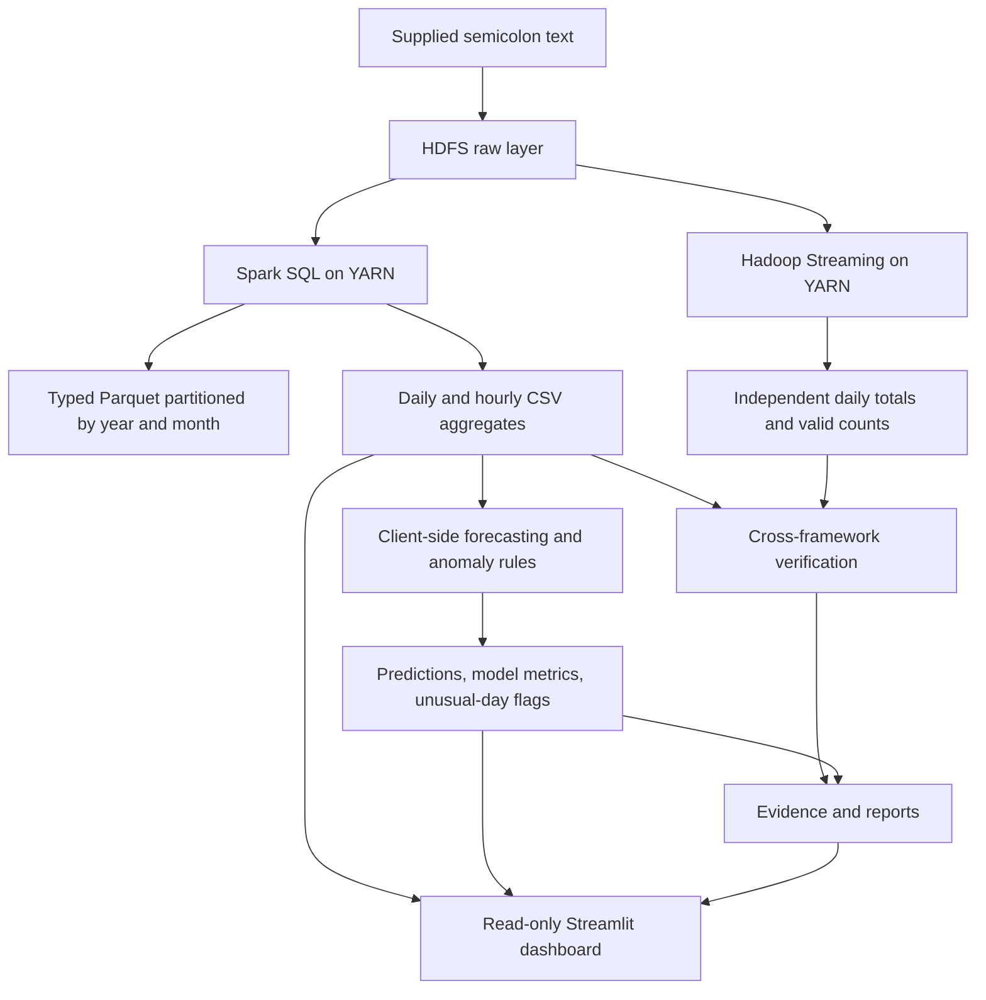
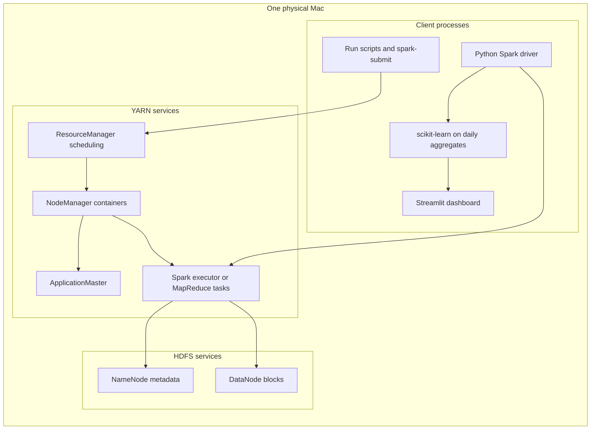
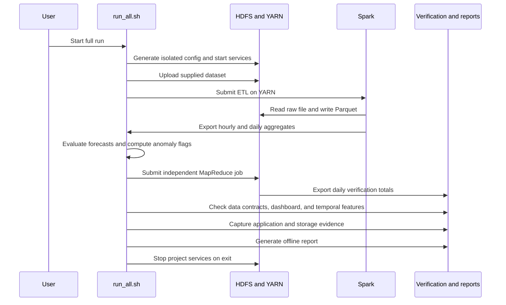

# WattWise

**Household Energy Analytics and Forecasting Using Hadoop and Spark**

## Household Electricity Analytics with Hadoop, HDFS, YARN, Spark, and MapReduce

An end-to-end big data course project that converts minute-level electricity readings into verified energy summaries, demand patterns, next-day forecasting benchmarks, and unusual-consumption flags.

**Verified scope:** 2,075,259 source records · 2,049,280 valid power readings · 1442 calendar days · two successful YARN applications · eight data checks · nine automated tests.

The project uses the supplied dataset at `/Users/neev/Downloads/BIGDATA/household_power_consumption.txt`. Its working directory is `/Users/neev/Downloads/BIGDATA/WattWise`. The implemented deployment is a single-node pseudo-distributed cluster: HDFS and YARN services run as separate processes on one Mac. Modeling runs on small daily aggregates in the client process.

## Contents

1. [Quick start](#quick-start)
2. [Problem, objectives, and project scope](#problem-objectives-and-project-scope)
3. [Dataset origin and provenance](#dataset-origin-and-provenance)
4. [Complete input data dictionary](#complete-input-data-dictionary)
5. [Electricity units and energy calculations](#electricity-units-and-energy-calculations)
6. [Measured dataset profile](#measured-dataset-profile)
7. [Missing data and temporal coverage](#missing-data-and-temporal-coverage)
8. [End-to-end architecture](#end-to-end-architecture)
9. [Deployment and service responsibilities](#deployment-and-service-responsibilities)
10. [Data layers and output schemas](#data-layers-and-output-schemas)
11. [Spark processing explained](#spark-processing-explained)
12. [Independent Hadoop MapReduce verification](#independent-hadoop-mapreduce-verification)
13. [Forecasting methodology](#forecasting-methodology)
14. [Model results and interpretation](#model-results-and-interpretation)
15. [Anomaly detection](#anomaly-detection)
16. [Dashboard pages and filter behavior](#dashboard-pages-and-filter-behavior)
17. [Installation and full reproduction](#installation-and-full-reproduction)
18. [Verification and execution evidence](#verification-and-execution-evidence)
19. [Repository map](#repository-map)
20. [SQL and cluster inspection examples](#sql-and-cluster-inspection-examples)
21. [Troubleshooting](#troubleshooting)
22. [Limitations and a future scaling path](#limitations-and-a-future-scaling-path)
23. [Presentation and viva notes](#presentation-and-viva-notes)
24. [References and dataset attribution](#references-and-dataset-attribution)

## Quick start

For a fresh GitHub checkout, create the Python environment below, then obtain the original dataset with `.venv/bin/python scripts/fetch_dataset.py`. The raw 133 MB file is excluded from Git; saved aggregates and execution evidence are included. The download utility verifies the exact source checksum. Dataset attribution and access details are in `data/README.md`.

Use the precomputed results immediately:

```bash
cd /Users/neev/Downloads/BIGDATA/WattWise
bash scripts/dashboard.sh
```

Open [the dashboard](http://127.0.0.1:18501/). Hadoop does not need to remain running to explore saved results.

| Deliverable | Location | Use |
|---|---|---|
| Interactive application | `app.py` | Explore six dashboard pages |
| Offline report | `results/PROJECT_REPORT.html` | Read methodology and interactive figures without a server |
| Submission narrative | `docs/PROJECT_REPORT.md` | Written academic report with actual results |
| Advanced guide | `README.md` | Dataset, architecture, implementation, and reproduction |
| Formatted advanced guide | `docs/ADVANCED_README.html` | Read this guide with rendered tables and architecture diagrams |
| Viva preparation | `docs/VIVA.md` | Explain design decisions and limitations |
| Source profile | `results/dataset_statistics.csv` | Full-input descriptive statistics |
| Yearly profile | `results/dataset_annual.csv` | Observed yearly energy and coverage counts |

## Problem, objectives, and project scope

A long sequence of meter readings is difficult to interpret directly. This project addresses six questions:

1. How much energy was actually observed, and how much information is missing?
2. How does demand change by date, hour, and weekday?
3. How much observed energy belongs to each monitored circuit?
4. Can earlier observations predict daily consumption on later dates?
5. Which days differ strongly from their recent consumption history?
6. Can two independent processing frameworks reproduce the same totals?

| Objective | Implemented method | Evidence |
|---|---|---|
| Process millions of records | Spark SQL executed on YARN | Spark application and job log |
| Store typed, queryable data | HDFS Parquet partitioned by year/month | Lake path and HDFS storage report |
| Account for missing readings | Null preservation, valid-minute counts, coverage thresholds | Manifest and quality checks |
| Verify calculations independently | Hadoop Streaming MapReduce | Daily Spark/MapReduce agreement |
| Evaluate forecasting honestly | Chronological train/validation/test splits | Model metrics and dated predictions |
| Explain consumption | Six-page dashboard and offline report | Tables, figures, and filtered exports |

This is a batch analytics and forecasting project. It does not implement live streaming, city-wide monitoring, a Hive service, automatic appliance identification, or a production multi-machine deployment.

### Why use big data tools here?

The file has millions of rows but only about 132.96 MB of text; it can fit on a laptop. Hadoop is used to demonstrate distributed storage, resource scheduling, parallel execution, typed data-lake output, and independent verification. A larger deployment could reuse the processing pattern, but this project does not establish multi-node speedup.

For the usual “five Vs” discussion: volume is the measured row count; velocity is historical minute sampling, not current ingestion; variety consists of timestamp and electrical measurements; veracity concerns missing readings and unit correctness; value is the resulting analysis and forecast evaluation.

## Dataset origin and provenance

The source is **Individual Household Electric Power Consumption**, by Georges Hebrail and Alice Berard, distributed through UCI. It describes one household in Sceaux, France, with minute sampling between December 2006 and November 2010. UCI identifies it as multivariate time-series data. [UCI dataset documentation](https://archive.ics.uci.edu/dataset/235/individual+household+electric+power+consumption)

The following facts are measured from the supplied local file and saved outputs:

| Property | Verified value |
|---|---|
| Original filename | `household_power_consumption.txt` |
| Data records, excluding header | 2,075,259 |
| Text lines, including header | 2,075,260 |
| Input columns | 9: two time identifiers and seven measurement fields |
| First source timestamp | 2006-12-16 17:24:00 |
| Last source timestamp | 2010-11-26 21:02:00 |
| Frequency | One record per calendar minute within those boundaries |
| File size | 132,960,755 bytes; 132.96 decimal MB; 126.80 MiB |
| Delimiter | Semicolon (`;`) |
| Decimal separator | Period (`.`) |
| Measurement missing markers | `?` and empty fields in this local file |
| Timestamp duplicates | 0 |
| Absent minute timestamps inside the source interval | 0 |
| Explicit source timezone | Not supplied |
| Built-in prediction target | None; this project derives an observed daily-energy target |

**SHA-256 of the exact supplied file:**

```text
4259c9d7ece5dbee9ab8d53682baac68d791c864f0f64a52b4043cb3b90894b7
```

This hash distinguishes the actual input from another copy or a changed file. The profile should be regenerated when the source changes. Published metadata and local observations are intentionally distinguished: UCI describes missing fields generally, while this copy includes `?` tokens.

### Example original record

```text
Date;Time;Global_active_power;Global_reactive_power;Voltage;Global_intensity;Sub_metering_1;Sub_metering_2;Sub_metering_3
16/12/2006;17:24:00;4.216;0.418;234.840;18.400;0.000;1.000;17.000
```

Dates later in the file include single-digit day/month values. Parsing uses `d/M/yyyy HH:mm:ss`, which accepts them. The parser does not assume that every day or month is zero-padded.

## Complete input data dictionary

| Input field | Parsed representation | Meaning and interpretation | Unit / format |
|---|---|---|---|
| `Date` | Part of `timestamp` | Observation calendar date | Day/month/year |
| `Time` | Part of `timestamp` | Observation clock time | `HH:mm:ss` |
| `Global_active_power` | Nullable double | Minute-average active power; used to derive observed energy | kW |
| `Global_reactive_power` | Nullable double | Reactive-power measurement; retained for exploration | UCI lists kW; see note below |
| `Voltage` | Nullable double | Minute-average voltage | V |
| `Global_intensity` | Nullable double | Minute-average current | A |
| `Sub_metering_1` | Nullable double | Kitchen circuit | Wh per minute |
| `Sub_metering_2` | Nullable double | Laundry-room circuit | Wh per minute |
| `Sub_metering_3` | Nullable double | Water-heater / air-conditioner circuit | Wh per minute |

UCI associates circuit 1 with kitchen equipment, circuit 2 with laundry-room equipment including a refrigerator, and circuit 3 with water heating and air conditioning. These are grouped circuits, not individual device labels. UCI describes the reactive-power field in kilowatts; conventional reactive-power notation is kVAR. This project preserves its numeric values and bases energy calculations only on active power. [Variable descriptions](https://archive.ics.uci.edu/dataset/235/individual+household+electric+power+consumption)

A null means “not measured here,” not “the household used zero electricity.” Zero is a real numeric value for many sub-meterings and remains distinct from a null.

## Electricity units and energy calculations

**Power** measures the rate of energy use. **Energy** accumulates power over time. The minute-average active-power reading must be multiplied by a one-minute duration before aggregation.

```text
Minute energy (kWh) = Global_active_power (kW) × (1/60 hour)
Daily observed energy (kWh) = sum of valid minute energy contributions
Circuit energy (kWh) = sum of minute sub-metering values (Wh) / 1000
Other residual energy (Wh) = Global_active_power × 1000/60 − Sub_metering_1 − Sub_metering_2 − Sub_metering_3
```

For the sample record:

```text
Total minute energy = 4.216 / 60 = 0.0702667 kWh = 70.2667 Wh
Monitored circuits = 0 + 1 + 17 = 18 Wh
Other residual = 70.2667 − 18 = 52.2667 Wh
```

Adding kW readings and calling the result kWh would overstate energy by a factor of 60. Circuit Wh values are already per-minute energy and should not be divided by 60 again.

Residual energy is a calculated difference, not a fourth meter. The dataset has 1,050 minutes where residual energy is below −0.01 Wh. The pipeline retains these signed values and counts them rather than clamping them to zero. Small inconsistencies can arise from measurement and rounding; the project does not establish their physical cause.

## Measured dataset profile

The statistics below are computed on all non-null values in the supplied file. They are rounded for display. Quantiles describe minute measurements, not daily totals. The underlying CSV retains greater precision.

| Measurement | Minimum | 25th percentile | Median | Mean | 75th percentile | Maximum | Std. dev. |
|---|---:|---:|---:|---:|---:|---:|---:|
| `Global_active_power` | 0.076 | 0.308 | 0.602 | 1.092 | 1.528 | 11.122 | 1.057 |
| `Global_reactive_power` | 0.000 | 0.048 | 0.100 | 0.124 | 0.194 | 1.390 | 0.113 |
| `Voltage` | 223.200 | 238.990 | 241.010 | 240.840 | 242.890 | 254.150 | 3.240 |
| `Global_intensity` | 0.200 | 1.400 | 2.600 | 4.628 | 6.400 | 48.400 | 4.444 |
| `Sub_metering_1` | 0.000 | 0.000 | 0.000 | 1.122 | 0.000 | 88.000 | 6.153 |
| `Sub_metering_2` | 0.000 | 0.000 | 0.000 | 1.299 | 1.000 | 80.000 | 5.822 |
| `Sub_metering_3` | 0.000 | 0.000 | 1.000 | 6.458 | 17.000 | 31.000 | 8.437 |

Every measurement field has 2,049,280 valid values and 25,979 missing values. Median active power is 0.602 kW while mean active power is about 1.092 kW; higher-demand minutes pull the mean above the median. Zero medians in circuit 1 and circuit 2 indicate that those circuits often recorded no energy during a minute. They do not indicate missing data.

### Observed energy by calendar year

| Year | Calendar days | Valid minute readings | Eligible days | Observed energy (kWh) |
|---|---:|---:|---:|---:|
| 2006 | 16 | 21,992 | 15 | 696.89 |
| 2007 | 365 | 521,669 | 361 | 9,711.80 |
| 2008 | 366 | 526,905 | 366 | 9,414.88 |
| 2009 | 365 | 521,320 | 361 | 9,371.92 |
| 2010 | 330 | 457,394 | 314 | 8,088.25 |

2006 and 2010 are partial years. Yearly totals include observed readings even on low-coverage days, so they are not annual consumption estimates for a complete year. A smaller total can reflect a shorter period or missing observations as well as lower demand.

### Whole-dataset energy summary

| Measurement | Value | Interpretation |
|---|---:|---|
| Observed total energy | 37,283.75 kWh | Sum over valid minute readings |
| Mean active power | 1.092 kW | Average over valid minutes |
| Maximum minute active power | 11.122 kW | Largest minute-average reading |
| Eligible-day average | 26.19 kWh/day | Observed energy on days meeting the 95% threshold |
| Kitchen observed energy | 2,299.135 kWh | Circuit 1 |
| Laundry-room observed energy | 2,661.031 kWh | Circuit 2 |
| Water heating / climate energy | 13,235.167 kWh | Circuit 3 |
| Other signed residual energy | 19,088.415 kWh | Total minus monitored circuits |

The filtered dashboard's total can differ from the whole-source total because the default view excludes low-coverage and partial days. Both are observed totals under different, explicitly stated selections.

## Missing data and temporal coverage

| Quality property | Value |
|---|---:|
| Missing active-power readings | 25,979 |
| Missing fraction of source rows | 1.252% |
| Rows where all seven measurement fields are missing | 25,979 |
| Calendar days with no valid active-power readings | 9 |
| Calendar days in the source | 1442 |
| Days meeting ≥95% daily coverage | 1,417 |
| Days excluded by daily coverage | 25 |
| Invalid parsed timestamps | 0 |
| Duplicate timestamps | 0 |
| Negative active-power readings | 0 |

All expected minute timestamps inside the first/last source boundaries exist. Missing **measurements** therefore differ from missing **timestamps**.

### Coverage rules

```text
Daily coverage = valid active-power minutes / 1440
Hourly coverage = valid active-power minutes / 60
Daily modeling eligibility = daily coverage ≥ 0.95
Hourly demand-profile eligibility = hourly coverage ≥ 0.95
```

The first day contains 396 valid minutes, or 27.50% of a full day. The final day contains 1,263 valid minutes, or 87.71%. Both are below the daily-modeling threshold even though they represent valid observations within the source boundaries.

Missing readings are preserved as nulls. Spark returns null energy for an entirely missing day. The independent MapReduce output retains that date with zero valid readings and a zero accumulated sum. Verification reconciles these representations **only for comparing accumulated sums**; it does not infer zero true consumption.

No interpolation or forward fill is performed for energy targets. Forecast features are constructed on a complete calendar-day index. A missing Tuesday does not move Wednesday's seven-day lag onto another weekday. The model discards incomplete target or feature windows, leaving 1,165 evaluated modeling rows and excluding 277 calendar days, including early warm-up days.

The source wall-clock times are not converted to Indian or French local time. Spark uses a fixed UTC session to make parsing deterministic; metadata is formatted inside Spark before collection to avoid a host-timezone shift. No daylight-saving correction is claimed because source timezone information is absent.

## End-to-end architecture

### Logical data flow



The two execution branches read the same source independently. Spark produces the lake and analytical aggregates. MapReduce is a separate numerical check, not a second copy of the Spark job. Their agreement makes unit and aggregation mistakes easier to detect.

### What runs where?



Spark uses **YARN client mode**: the driver remains in the local client process while YARN manages the ApplicationMaster and executor containers. Changing this project to cluster mode requires adapting where local aggregate files and reports are written; replacing the submit flag alone is insufficient. [Spark 3.5.6 on YARN](https://spark.apache.org/docs/3.5.6/running-on-yarn.html)

### Run lifecycle



## Deployment and service responsibilities

| Component | Responsibility in this project | What it does not do |
|---|---|---|
| HDFS NameNode | Maintains filesystem metadata and block locations | Does not store all data blocks or train models |
| HDFS DataNode | Stores the raw and Parquet blocks | Does not select forecast models |
| YARN ResourceManager | Schedules application resources | Does not calculate electricity totals |
| YARN NodeManager | Starts and monitors containers on the worker | Does not provide the dashboard |
| ApplicationMaster | Coordinates an application's containers | Does not replace HDFS |
| Spark driver | Plans work, coordinates executors, exports small aggregates | Does not process the source exclusively in pandas |
| Spark executor | Executes distributed parsing, SQL aggregations, and writes | Does not train this project's scikit-learn models |
| MapReduce mapper/reducer | Independently computes per-date observed energy and counts | Does not create the forecast |
| scikit-learn | Fits/evaluates models on daily aggregates | Does not run on YARN in this implementation |
| Streamlit + Plotly | Displays saved aggregates, metrics, and evidence | Does not represent a live meter feed |

Hadoop's pseudo-distributed mode uses separate daemon processes on one node. The source project follows that teaching pattern with its own directories and ports. [Hadoop single-node setup](https://hadoop.apache.org/docs/r3.3.6/hadoop-project-dist/hadoop-common/SingleCluster.html)

### Verified configuration

| Setting | Project value |
|---|---|
| Java | 11.0.32 in the recorded environment |
| Hadoop | 3.3.6 |
| Spark | 3.5.6 |
| Python | 3.11.16 |
| Spark master | `yarn` |
| Spark deploy mode | `client` |
| Spark driver heap | 1 GiB |
| Spark executors | One executor, two cores, 1 GiB heap |
| Spark ApplicationMaster heap | 512 MiB, plus framework overhead |
| Spark SQL shuffle partitions | 8 |
| YARN worker advertised resources | 4,096 MiB and four virtual cores |
| YARN allocation range | 256–4,096 MiB per container |
| Queue | `default`, capacity 100% |
| HDFS replication | 1 |
| MapReduce job | Two map tasks and one reduce task in the recorded run |
| MapReduce task / AM memory request | 512 MiB each |

These are container and JVM settings, not a claim that the whole application needs exactly that much physical RAM. The NodeManager's physical/virtual memory enforcement is disabled in this local macOS teaching configuration; it is not a production sizing policy.

### Ports and isolation

| Service | Address / port | Availability |
|---|---|---|
| HDFS RPC | `hdfs://localhost:19000` | While the cluster is running |
| NameNode UI | `http://127.0.0.1:19870` | While the cluster is running |
| DataNode transfer / HTTP / IPC | 19866 / 19864 / 19867 | Project service ports |
| YARN client RPC | `localhost:18032` | While ResourceManager is running |
| YARN scheduler / tracker / admin | 18030 / 18031 / 18033 | Project service ports |
| ResourceManager UI | `http://127.0.0.1:18088` | While the cluster is running |
| NodeManager / localizer / UI | 18041 / 18040 / 18042 | While NodeManager is running |
| Dashboard | `http://127.0.0.1:18501` | While `dashboard.sh` is running |

`configure_cluster.py` generates XML in the project's `conf/`. NameNode/DataNode state, container files, PID files, and logs are under `runtime/`. The first startup formats only this project's NameNode storage, and only when its `current/VERSION` file does not exist. Existing global Hadoop configuration and the original source file are not replaced.

## Data layers and output schemas

### Storage layers

| Layer | Location | Contents |
|---|---|---|
| Original source | `../household_power_consumption.txt` | Supplied semicolon text, untouched |
| Raw / bronze | `hdfs://localhost:19000/energy-insights/raw/household_power_consumption.txt` | HDFS copy of the input |
| Typed / silver | `hdfs://localhost:19000/energy-insights/silver/` | Nullable measurements, timestamps, energy/residual fields, year/month partitions |
| Analytical / gold | Local `results/` | Daily/hourly aggregates, prediction and anomaly tables, evidence |
| Model artifact | Local `results/model.pkl` | Selected evaluation model and feature names |

“Bronze/silver/gold” describes the logical stages, not three additional deployed products. The directory names in the actual project are `raw`, `silver`, and `results`.

Example lake layout:

```text
/energy-insights/silver/
└── year=2009/
    └── month=1/
        └── part-....snappy.parquet
```

In the recorded run, the raw HDFS file used 132,960,755 bytes and the processed Parquet dataset used 34,329,777 logical bytes. This is about 74.18% less storage than the text file, despite the derived fields. It is a measured storage comparison, not a query-speed benchmark. Replication is one in this cluster.

### Silver record schema

| Field | Type | Meaning |
|---|---|---|
| `timestamp` | Timestamp | Parsed source wall-clock minute |
| `global_active_power`, `global_reactive_power` | Nullable double | Original power measurements |
| `voltage`, `global_intensity` | Nullable double | Original voltage/current measurements |
| `sub_metering_1`, `sub_metering_2`, `sub_metering_3` | Nullable double | Original minute Wh measurements |
| `energy_kwh` | Nullable double | `global_active_power / 60` |
| `unmetered_wh` | Nullable double | Signed calculated residual |
| `year`, `month` | Integer partition keys | Calendar extraction used in lake paths |

### Daily output: `results/daily.csv`

One row per source calendar day; unique date key.

| Field | Meaning |
|---|---|
| `date` | Calendar date |
| `recorded_minutes` | Source rows, including rows with missing power |
| `valid_minutes` | Non-null active-power readings |
| `energy_kwh` | Sum of observed minute energy; null if all readings are missing |
| `mean_kw` | Average active power over valid minutes |
| `peak_kw` | Largest valid minute-average power |
| `voltage` | Mean of valid voltage measurements |
| `kitchen_kwh`, `laundry_kwh`, `climate_kwh` | Observed circuit energy sums |
| `other_kwh` | Signed residual energy sum |
| `coverage` | `valid_minutes / 1440` |
| `eligible` | Whether coverage is at least 0.95 |

### Other outputs

| File | Main fields / purpose |
|---|---|
| `hourly.csv` | `timestamp`, `valid_minutes`, `energy_kwh`, `mean_kw`, `peak_kw`, `coverage`; one calendar-hour bucket |
| `forecast_test.csv` | `date`, observed target, weekly baseline, each candidate prediction, and validation-selected `prediction_kwh` |
| `anomalies.csv` | `date`, `energy_kwh`, `past_median_kwh`, `robust_z` for flagged days |
| `mapreduce_daily.tsv` | Headerless date, accumulated kWh, and valid-reading count |
| `manifest.json` | Row/timestamp quality, totals, input/lake paths, actual Spark master, application ID, ETL duration |
| `metrics.json` | Validation/test scores, split boundaries, selected model, anomaly count, evaluation description |
| `verification.json` | Eight successful data checks for this supplied source |
| `ui_verification.json` | Nine successful automated tests with verification timestamp |
| `yarn_applications.json` | Saved ResourceManager response showing Spark and MapReduce completion |
| `hdfs_status.txt`, `hdfs_storage.txt` | Captured filesystem and logical-storage evidence |
| `dataset_statistics.csv`, `dataset_annual.csv`, `dataset_profile.json` | Full-source descriptive profile, annual observations, size/hash provenance |

## Spark processing explained

1. **Upload:** `run_pipeline.sh` copies the original file to the project's raw HDFS path.
2. **Read:** Spark uses a declared nine-string-column schema and semicolon delimiter. `?` becomes null; empty numeric fields also become null after parsing/casting.
3. **Parse:** `Date` and `Time` become a timestamp; measurement fields become nullable doubles.
4. **Validate:** Compute counts, first/last timestamps, numeric missingness, negative active power, and duplicate timestamps. Invalid timestamps, duplicates, or negative active power stop ETL.
5. **Derive:** Compute minute kWh and the signed unmetered Wh residual. Keep the source values intact.
6. **Persist:** Write Parquet using year/month partition directories. The write is `overwrite` for this project's silver output.
7. **Aggregate:** Spark SQL computes observed daily and hourly summaries and valid-reading counts.
8. **Collect small results:** Only the aggregate tables are converted to pandas and exported as CSV. The minute-level source is not collected into pandas by the distributed pipeline.
9. **Record lineage:** Save master, application ID, paths, quality, totals, and elapsed ETL time in the manifest.

The parsed DataFrame is cached because several actions reuse it. Grouping by date/hour triggers distributed aggregation and shuffle. Year/month partitions support filtering by partition keys; the example SQL includes `EXPLAIN` to inspect that plan. Actual executor parallelism remains limited by this one-worker configuration.

The recorded ETL duration is 28.18 seconds, including parsing, checks, lake writing, and aggregate export. It excludes model evaluation, MapReduce verification, cluster startup, and document generation. It is one observed run, not an average or a fair comparison against other engines.

## Independent Hadoop MapReduce verification

The mapper reads source lines directly, skips the header, parses the date, and converts numeric active power into `kW/60` kWh. It accumulates `(energy_sum, valid_count)` by date within each mapper before emitting records, reducing shuffle volume.

The date key is initialized even if a reading is missing. Thus a completely missing day remains represented as a zero-count group. Hadoop shuffles records by date; the reducer merges partial sums and counts. The job uses a unique output directory on each run.

```text
Input minute rows → per-mapper date totals → Hadoop shuffle/sort → reducer totals → TSV
```

The recorded job launched two mappers and one reducer. Its input-record counter includes the text header, so it is one larger than the source measurement count. Verification joins the output to Spark by date, requires one row per day, compares valid counts exactly, and compares energy totals with a floating-point tolerance of 1e-6 kWh. Different accumulation order can cause insignificant last-decimal differences.

This is batch MapReduce using the Hadoop Streaming interface for Python mapper/reducer programs. It is unrelated to live event streaming.

## Forecasting methodology

### Target and prediction contract

The target is **observed daily energy in kWh on days with ≥95% coverage**. It is not a guaranteed estimate of complete-day true consumption; up to 5% of minute measurements can still be missing on an eligible day.

The task is rolling **one-day-ahead** prediction. When predicting day `t`, earlier daily observations are available. The current day's power readings and energy target are never input features.

### Feature design

| Features | Construction | Reason |
|---|---|---|
| `lag_1`, `lag_2` | Energy one/two calendar days earlier | Recent demand level |
| `lag_7`, `lag_14`, `lag_28` | Energy one/two/four weeks earlier | Weekly recurrence |
| `mean_7`, `mean_28` | Rolling mean after a one-day shift | Recent baseline without using today's target |
| `std_7`, `std_28` | Rolling standard deviation after a one-day shift | Recent variability |
| `weekday` | Monday=0 through Sunday=6 | Day-of-week pattern |
| `weekend` | 1 on Saturday/Sunday | Simple weekday/weekend distinction |
| `season_sin`, `season_cos` | Sine/cosine of day-of-year / 365.25 | Continuous yearly seasonal cycle |

There are 13 input features. Calendar reindexing happens before shifting. No target interpolation is used. Incomplete features/targets are dropped.

### Chronological splits

| Split | First eligible date | Last eligible date | Usable days |
|---|---|---|---:|
| Train | 2007-01-14 | 2009-02-10 | 699 |
| Validation | 2009-02-11 | 2009-11-30 | 233 |
| Test | 2009-12-01 | 2010-11-25 | 233 |

Splits are approximately 60%/20%/20% of the usable rows, not randomly selected dates. The date intervals include gaps because incomplete windows are excluded.

Each learned candidate is trained on the first split and scored on validation. The weekly baseline uses the prior-week observation directly. Lowest validation MAE chooses the model, including the baseline as a candidate. Learned candidates are then refit using train plus validation and scored on test. Test results are reported after selection; they do not determine which model is deployed in the dashboard.

### Model configuration

| Candidate | Actual configuration | Purpose |
|---|---|---|
| Weekly baseline | Prediction = `lag_7` | Simple benchmark; no learned parameters |
| Ridge regression | StandardScaler + Ridge, `alpha=10` | Regularized linear prediction |
| Random forest | 200 trees, depth ≤10, leaf size ≥5, seed 42, two jobs | Nonlinear feature interactions |
| Histogram gradient boosting | 200 iterations, ≤15 leaves, L2=5, seed 42 | Sequential nonlinear corrections |

Scaler fitting is part of the Ridge training pipeline and uses the relevant training portion. Learned predictions are clipped at zero to prevent negative energy forecasts. Other unspecified estimator settings follow the versions frozen in `requirements.lock.txt`.

### Metrics

```text
MAE = mean(abs(observed − predicted))                  [kWh/day]
RMSE = sqrt(mean((observed − predicted)^2))             [kWh/day]
WAPE = 100 × sum(abs(observed − predicted)) / sum(abs(observed)) [%]
```

MAE is the average absolute daily error. RMSE penalizes larger mistakes more strongly. WAPE is relative to total observed test energy; it is not an accuracy percentage.

## Model results and interpretation

| Model | Validation MAE (kWh) | Test MAE (kWh) | Test RMSE (kWh) | Test WAPE (%) | Selected |
|---|---:|---:|---:|---:|---|
| Weekly baseline | 5.737 | 5.996 | 8.026 | 24.037 | No |
| Ridge | 4.509 | 4.288 | 5.812 | 17.192 | Yes |
| Random forest | 4.566 | 3.943 | 5.356 | 15.809 | No |
| Gradient boosting | 4.900 | 4.238 | 5.526 | 16.992 | No |

**Ridge is selected because it has the lowest validation MAE.** Its test MAE is 4.288 kWh/day, compared with 5.996 kWh/day for the weekly baseline: about 28.5% less absolute error. Random forest happens to achieve lower test MAE, but choosing it after inspecting test results would misuse the holdout for selection.

The selected model's WAPE is 17.19%. This does not mean “82.81% accurate” under a universal accuracy definition. It means total absolute error is about 17.19% of the observed test energy.

The final source day is incomplete, so the prospective next-day feature vector contains missing inputs. `next_day_forecast` is therefore null. Historical predictions on eligible test dates still exist. A missing future prediction is an explicit data-completeness decision, not evidence that the model failed to fit.

`model.pkl` stores the selected evaluation artifact when the analysis runs; it is not versioned in Git. Recreate it with `.venv/bin/python src/analyze.py --results results` using the saved daily aggregates. The standalone notebook/online model-serving API and prediction intervals are not implemented. Use the version-locked project environment when inspecting this artifact.

## Anomaly detection

The rule operates on eligible daily energy:

```text
Reference window = previous 28 calendar days, excluding today
Required observations = at least 14 eligible days
Median = median(reference energy)
MAD = median(abs(reference energy − Median))
Robust z = (today's energy − Median) / (1.4826 × MAD)
Flag if abs(Robust z) > 3.5
```

A zero MAD yields an undefined denominator and does not produce a score through this implementation. Null targets/reference values are excluded by the eligibility/rolling rules. The current day does not affect its reference window.

There are 53 flagged days in the full dataset. Positive scores indicate unusually high demand; negative scores indicate unusually low demand compared with the recent reference. Holidays, occupancy, weather, or measurement problems are possible hypotheses, not demonstrated causes. No labeled fault dataset is available, so detection precision/recall is not claimed.

## Dashboard pages and filter behavior

| Page | Information shown |
|---|---|
| Overview | Selected energy, daily average, minute peak, coverage, demand chart, highest observed day |
| Consumption | Daily trend, circuit-energy shares, weekday/hour demand heatmap, selected reading table |
| Forecasting | Validation-selected model, full-test benchmark, date-filtered predictions and export, candidate comparison |
| Anomalies | Date-filtered unusual-day flags, scores, direction, downloadable selection |
| Data & platform | Source quality, selected coverage chart, architecture, saved YARN evidence, checks |
| Project & downloads | Reports, source explanation, selected daily CSV, run/setup instructions |

Quick range chooses a year; the observation window supports custom dates. Coverage filtering affects consumption and anomaly views. Forecast plots/exports use selected dates, but benchmark scores retain the full test period and are labeled accordingly. Data/platform quality counts describe the full source; its coverage chart follows the selected dates.

Charts preserve missing-day gaps rather than connecting omitted days. The heatmap always has seven weekday rows and 24 hour columns; cells without observations remain blank. Empty, missing-only, and out-of-test selections show explanations. Downloaded daily/prediction selections obey the displayed filters. The saved YARN response describes completed runs, not live cluster health.

## Installation and full reproduction

### Prerequisites and supported local setup

The verified machine has Java 11, Hadoop 3.3.6, Python 3.11, and the project virtual environment. The scripts default to:

```text
JAVA_HOME=/opt/homebrew/opt/openjdk@11
HADOOP_HOME=/usr/local/hadoop
Python interpreter=WattWise/.venv/bin/python
```

`JAVA_HOME` and `HADOOP_HOME` can be supplied before running the scripts. The generated MapReduce classpath and Streaming JAR path are also tied to this Hadoop installation/version. A different installation must adapt those references in the configuration generator and MapReduce launcher; setting one environment variable alone is insufficient.

### Create or rebuild the project environment

```bash
cd /Users/neev/Downloads/BIGDATA/WattWise
/opt/homebrew/bin/python3.11 -m venv .venv
.venv/bin/pip install -r requirements.lock.txt
```

The lock file records the environment used for the verified results. `requirements.txt` gives the broader dependency ranges; use the lock for closest reproduction. Do not move an existing virtual environment between directories; recreate it after relocating the ZIP.

### Full Hadoop/YARN execution

```bash
bash scripts/run_all.sh
```

The script starts the isolated services, uploads the source, executes Spark, evaluates models, runs MapReduce, verifies data and dashboard behavior, captures evidence, generates reports, and stops services on exit. The original source is untouched. Re-runs overwrite this project's silver and analytical outputs; each MapReduce result has its own run path.

Alternative source location:

```bash
bash scripts/run_all.sh /absolute/path/household_power_consumption.txt
```

The test contracts assume the supplied dataset's row count and timestamp boundaries. Adapting the pipeline to another dataset requires adapting those contracts and documenting the new source. The original report hashing step resolves the source beside the project; if an alternative input is used, confirm that provenance points to that input before treating the report as authoritative.

### Individual components

```bash
bash scripts/start_cluster.sh
bash scripts/run_pipeline.sh yarn
bash scripts/run_mapreduce.sh
.venv/bin/python scripts/verify_project.py
.venv/bin/python scripts/build_report.py
.venv/bin/python scripts/profile_dataset.py
.venv/bin/python scripts/build_readme.py
bash scripts/stop_cluster.sh
```

The profiling utility is an optional local descriptive audit: it reads the modest supplied file into pandas to compute exact quantiles. It is separate from the distributed ETL and is not a memory-scalable replacement for Spark.

### Local Spark fallback

```bash
bash scripts/run_pipeline.sh local /absolute/path/household_power_consumption.txt
.venv/bin/python tests/verify_results.py --results results
```

This runs Spark with two local worker threads and writes Parquet under `data/silver`. It does not demonstrate YARN or execute the independent Hadoop job. The manifest records the actual master. If retained evidence is from an earlier YARN run, interpret it as historical evidence, not proof that this new local run used YARN.

## Verification and execution evidence

### Eight data checks

| Check | Why it matters |
|---|---|
| Source row count and wall-clock boundaries | Detect changed input or timezone-shifted provenance |
| Unique timestamps | Avoid double-counting a minute |
| Energy conservation | Circuit plus signed residual equals observed total |
| Hourly/daily agreement | Different aggregate granularities reconcile |
| Missing-data accounting | Valid counts equal raw minus missing measurements |
| Coverage bounds | Ratios remain within [0, 1] |
| Chronological forecast | Predictions are dated in increasing order and present |
| Independent MapReduce/Spark agreement | Separate engines reproduce daily totals and counts |

### Nine automated tests

The suite exercises all six pages, year presets, single-day heatmaps, missing-only days, ranges without test predictions, forecast-export boundaries, visible calendar gaps, seven-day calendar lags, and the requirement that editing current/future targets cannot alter today's features.

```bash
.venv/bin/python scripts/verify_project.py
```

Successful execution writes `ui_verification.json`. The independent-engine check requires `mapreduce_daily.tsv`; a local-only verification without that file cannot claim cross-framework agreement.

### Recorded YARN applications

| Framework / application | Application ID | Final state | Final status |
|---|---|---|---|
| EnergyInsights-Household-ETL | `application_1791813966040_0001` | FINISHED | SUCCEEDED |
| EnergyInsights-Daily-MapReduce | `application_1791813966040_0002` | FINISHED | SUCCEEDED |

Saved evidence retains the original EnergyInsights application names from runs before the WattWise rename; new submissions use WattWise names. Redacted historical job logs are included under `evidence/`; local paths and private addresses were removed while IDs, counters, and results were retained. Application IDs change on later runs. The source files for these values are `results/yarn_applications.json` and `results/manifest.json`. Job logs and the HDFS reports are retained under `runtime/logs/` and `results/`. A completed job status establishes execution through the toolchain; it does not establish multi-machine performance or production reliability.

## Repository map

```text
BIGDATA/
├── household_power_consumption.txt
└── WattWise/
    ├── README.md
    ├── app.py
    ├── requirements.txt
    ├── requirements.lock.txt
    ├── .streamlit/config.toml
    ├── conf/                         generated Hadoop configuration
    ├── src/
    │   ├── spark_pipeline.py         distributed ETL and SQL aggregation
    │   ├── analyze.py                forecast evaluation and anomaly rule
    │   ├── mapper.py                 independent per-mapper totals
    │   ├── reducer.py                shuffled-date reduction
    │   ├── dashboard_data.py         tested selection and gap logic
    │   └── report_layout.py          formatted offline-report renderer
    ├── scripts/
    │   ├── env.sh                    Java/Hadoop/Python project environment
    │   ├── configure_cluster.py      isolated service configuration
    │   ├── start_cluster.sh          initialize once, then start services
    │   ├── stop_cluster.sh           stop only project services
    │   ├── run_all.sh                complete pipeline lifecycle
    │   ├── run_pipeline.sh           Spark submission and modeling
    │   ├── run_mapreduce.sh          independent YARN job
    │   ├── verify_project.py         result checks and automated test evidence
    │   ├── dashboard.sh              read-only dashboard launcher
    │   ├── build_report.py           generated academic report
    │   ├── fetch_dataset.py          download and verify original UCI source
    │   ├── profile_dataset.py        optional full-source descriptive audit
    │   └── build_readme.py           formatted advanced-guide export
    ├── tests/                        data, UI, filter, temporal contracts
    ├── sql/analytics.sql             exploration and partition pruning
    ├── docs/                         report, advanced HTML guide, viva
    ├── results/                      measured analytical and evidence files
    └── runtime/                      local HDFS state, containers, PIDs, logs
```

The GitHub repository includes source code, documentation, saved analytical results, and execution evidence. The raw dataset, virtual environment, and live cluster storage are excluded from Git. Fetch the source with `scripts/fetch_dataset.py` and regenerate runtime state through setup and the pipeline. Previously exported ZIP packages may also contain the source dataset.

## SQL and cluster inspection examples

While the cluster is running, load its environment first:

```bash
source scripts/env.sh
hdfs dfs -ls /energy-insights/raw
hdfs dfs -ls /energy-insights/silver
hdfs dfs -du -s /energy-insights/raw /energy-insights/silver
yarn node -list
yarn application -list -appStates ALL
```

Spark SQL examples are in `sql/analytics.sql`. In a configured `spark-sql` session:

```sql
CREATE OR REPLACE TEMP VIEW readings USING parquet
OPTIONS (path 'hdfs://localhost:19000/energy-insights/silver');

SELECT year, month, SUM(energy_kwh) AS observed_kwh,
       COUNT(global_active_power) AS valid_minutes
FROM readings
GROUP BY year, month
ORDER BY year, month;

EXPLAIN SELECT AVG(global_active_power)
FROM readings
WHERE year = 2009 AND month = 1;
```

The first query aggregates observed energy and reports the number of valid readings. The second inspects whether partition filters are present; it does not independently benchmark pruning speed.

## Troubleshooting

| Symptom | Explanation / action |
|---|---|
| HDFS connection refused | Start the project cluster, source `scripts/env.sh`, and inspect `runtime/logs/` |
| YARN application stays accepted | Inspect worker registration, default queue capacity, available memory, and application diagnostics |
| Queue initialization failure | Regenerate config; `capacity-scheduler.xml` supplies the default queue |
| Native Hadoop library warning on macOS | This verified installation uses Java fallbacks; judge success from job status and outputs |
| Spark date parsing fails | Accept single-digit dates with `d/M/yyyy`; do not force zero-padded input |
| Timestamp shifts by host timezone | Format source boundary timestamps in Spark before collecting metadata |
| No forecast in a selected interval | Choose dates inside the held-out test period; model metrics remain full-test values |
| No prospective next-day forecast | The final feature window is incomplete; do not fill it silently |
| Selected energy differs from source total | Coverage/date filtering changes which observed readings are included |
| Entirely missing day has blank energy | This is intentional; true consumption is unknown |
| ZIP moved to a new folder | Recreate `.venv`, regenerate config, and adapt paths/install defaults |
| Source replaced with a different dataset | Update data contracts, rerun profiling, and regenerate documentation |

## Limitations and a future scaling path

The current findings apply to one historical household. Missing energy remains unknown. Circuit groups cannot isolate devices. No tariff, weather, occupancy, labeled faults, prediction intervals, or live ingestion feed is supplied. Passing automated tests does not establish anomaly-detection accuracy. The threshold of 95% trades data availability against incomplete targets; a different threshold could change retained days and model scores.

The current configuration has one worker and replication one. It demonstrates real HDFS/YARN execution but not multi-node speedup, replica resilience, service high availability, or a production security architecture. The macOS teaching setup needs configuration changes before deployment on other machines.

| Future work | Required implementation / validation |
|---|---|
| Multiple workers | Replace loopback addresses, distribute dependencies, change memory/core sizing, test failures |
| Higher HDFS replication | Add sufficient DataNodes and validate recovery behavior |
| Environment packaging | Ship a Python environment/container to workers rather than assume an identical local path |
| More households | Add household IDs and household-aware partitions/splits |
| Weather/occupancy features | Obtain aligned observations and prevent future-information leakage |
| Rolling-origin evaluation | Repeated chronological training windows and stable comparison protocol |
| Forecast intervals | Calibrate uncertainty on validation data and measure held-out coverage |
| Live ingestion | Add a source/transport and a separately tested streaming pipeline |
| Labeled anomaly detection | Acquire labels before claiming fault precision/recall |
| Reproducibility hardening | Atomic outputs, source-path-aware provenance, versioned runs, explicit dependency portability |

These items describe future scope, not existing features.

## Presentation and viva notes

For an eight-minute demonstration, present the problem and source first, explain power-to-energy conversion, show the two architecture branches, demonstrate consumption and forecast pages, show the completed YARN applications and independent agreement, then discuss limitations.

Useful answers:

- **HDFS versus YARN:** HDFS stores files; YARN allocates containers; Spark and MapReduce compute the results.
- **Why two frameworks?** Separate implementations strengthen confidence in totals and missing-value treatment.
- **Why not random splits?** Mixing past and future weakens the forecast evaluation.
- **Why Ridge when random forest has better test MAE?** Validation chooses the model before test inspection.
- **Why no future estimate?** Incomplete lag windows make that specific prediction unsupported.
- **Is a flag a fault?** No; it is a statistical deviation requiring investigation.
- **Is the file too small for Hadoop?** It fits on a laptop; the project demonstrates the toolchain and explains that boundary honestly.

Read `docs/VIVA.md` for the complete presentation script and additional questions.

## References and dataset attribution

Dataset attribution: Hebrail, G. & Berard, A. (2006). *Individual Household Electric Power Consumption* [Dataset]. UCI Machine Learning Repository. [DOI: 10.24432/C58K54](https://doi.org/10.24432/C58K54).

UCI lists the dataset under [CC BY 4.0](https://creativecommons.org/licenses/by/4.0/). Retain dataset attribution when sharing it. This does not assign a license to the project's source code. [UCI license and citation](https://archive.ics.uci.edu/dataset/235/individual+household+electric+power+consumption)

Technical references:

- [Hadoop 3.3.6 single-node setup](https://hadoop.apache.org/docs/r3.3.6/hadoop-project-dist/hadoop-common/SingleCluster.html)
- [Spark 3.5.6 on YARN](https://spark.apache.org/docs/3.5.6/running-on-yarn.html)
- [Spark 3.5.6 SQL guide](https://spark.apache.org/docs/3.5.6/sql-programming-guide.html)

Documentation snapshot: 12 October 2026. Numerical tables describe the supplied file and saved verified runs; future input, threshold, dependency, or model changes require refreshing the profile and guide.
