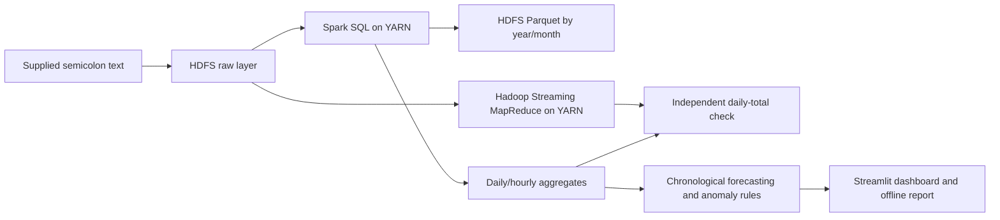

# WattWise: Household Electricity Analytics with Hadoop and YARN

## Abstract
This project processes 2,075,259 minute-level electricity observations using HDFS, YARN, Apache Spark and Hadoop Streaming MapReduce. It creates a partitioned Parquet lake, profiles data quality, analyzes consumption, evaluates next-day forecasting, and identifies unusual daily consumption. A Streamlit dashboard and an offline HTML report make the results reviewable. All reported measurements come from the supplied file.

## Problem and objectives
How does a household's electricity use change over time, which monitored circuits contribute energy, when does demand peak, and how accurately can tomorrow's consumption be predicted? Objectives are scalable ingestion, reliable energy accounting, temporal analysis, independent computation verification, and an honest out-of-time forecast benchmark.

## Dataset and provenance
UCI Individual Household Electric Power Consumption: one household in Sceaux, France. The supplied file spans 2006-12-16 17:24:00 to 2010-11-26 21:02:00. Source SHA-256: `4259c9d7ece5dbee9ab8d53682baac68d791c864f0f64a52b4043cb3b90894b7`. File: `household_power_consumption.txt`. UCI DOI: https://doi.org/10.24432/C58K54 . Source documentation: https://archive.ics.uci.edu/dataset/235/individual+household+electric+power+consumption . The dataset is historical and is not a live electricity feed. The source values have no explicit timezone metadata.

Global active power is kW; voltage is V; intensity is A. UCI labels the reactive-power field in kW, although conventional reactive-power notation is kVAR; this project retains it unchanged and derives energy only from active power. Sub-meterings are Wh per minute: kitchen, laundry, and water heating/air conditioning. Circuit labels are broad groupings, not appliance identification. Every observed minute contributes `active_power / 60` kWh. Residual energy is `active_power * 1000 / 60 - sub1 - sub2 - sub3` Wh. Small negative residuals are retained and counted because measurements and rounding do not guarantee exact circuit reconciliation.

## Architecture

HDFS stores data, YARN allocates containers, Spark executes distributed ETL, and MapReduce provides a second implementation. Modeling runs on small daily aggregates in the client process using scikit-learn. The verified deployment is a single-node pseudo-distributed teaching cluster, not a multi-machine scalability benchmark. Replication is one for this local cluster. The full raw file is modest in storage size; its millions of records demonstrate the big-data toolchain without claiming internet-scale volume.

## Data quality and cleaning
- Raw readings: 2,075,259; expected timestamp minutes: 2,075,259; absent timestamp minutes: 0.
- Missing active-power measurements: 25,979 (1.252%). Missing markers `?` become nulls, not zeros.
- Duplicate timestamps: 0; invalid timestamps: 0; negative active power: 0.
- Negative residual-energy minutes below -0.01 Wh: 1,050.
- Eligible days: 1,417 of 1,442, requiring at least 95% of 1,440 expected valid minute readings. Partial first/last days and low-coverage days are excluded from forecasts and typical daily summaries.

No energy is imputed. Daily/monthly sums are observed totals and can understate actual use where observations are missing. Forecast lag windows with missing/low-coverage days are dropped. Wall-clock values are parsed deterministically without shifting source times.

## Measured findings
- Total observed energy: 37,283.75 kWh.
- Mean power over valid minutes: 1.092 kW; largest minute reading: 11.122 kW.
- Eligible-day average observed consumption: 26.19 kWh/day.
- Highest average hourly demand among hours with ≥95% coverage: 20:00.
- Climate/water-heating circuit share of observed energy: 35.5%. This is a circuit share, not the share caused solely by air conditioning.

## Forecast methodology and results
Daily features include calendar lags 1, 2, 7, 14 and 28 days, previous-only rolling means/standard deviations, weekday, weekend and annual seasonality. The target is observed daily kWh on eligible days. Features contain no current-day measurements. Data is split chronologically into 60% train, 20% validation and 20% final test after invalid feature windows are removed. Models are Ridge, Random Forest, Histogram Gradient Boosting, and a same-weekday-last-week baseline. Minimum validation MAE selects the model before test evaluation. Models are refit on train plus validation for the final test.

| Model | Validation MAE (kWh) | Test MAE (kWh) | Test RMSE (kWh) | Test WAPE (%) | Selected |
|---|---:|---:|---:|---:|---|
| Weekly baseline | 5.737 | 5.996 | 8.026 | 24.037 |  |
| Ridge | 4.509 | 4.288 | 5.812 | 17.192 | Yes |
| Random forest | 4.566 | 3.943 | 5.356 | 15.809 |  |
| Gradient boosting | 4.900 | 4.238 | 5.526 | 16.992 |  |

Validation-selected model: **Ridge**. Final test MAE: **4.288 kWh**, RMSE: **5.812 kWh**, WAPE: **17.19%**. MAE reduction against the weekly baseline: **28.5%**. The table reports all model results for comparison, but test scores do not determine selection.

Split boundaries:

| Split | First eligible date | Last eligible date | Days |
|---|---|---|---:|
| Train | 2007-01-14 | 2009-02-10 | 699 |
| Validation | 2009-02-11 | 2009-11-30 | 233 |
| Test | 2009-12-01 | 2010-11-25 | 233 |
Evaluation is rolling one-day-ahead: yesterday's actual value is known before predicting today. This is not a multi-day open-loop forecast. 277 calendar days are excluded for target or feature completeness. A forecast after the dataset is withheld if its lag window is incomplete; this avoids an unsupported prediction. Future work can add weather, a second household, rolling-origin evaluation and uncertainty intervals.

## Anomaly detection
53 eligible days have absolute robust z-score >3.5 compared with the preceding 28 calendar days, with at least 14 usable observations. The reference is a past-only median and median absolute deviation. Flags are review candidates, not proven electrical faults or supervised anomaly labels. Seasonal changes and household behavior can produce flags.

## Execution evidence and verification
Spark 3.5.6 executed on `yarn` with application ID `application_1791813966040_0001`. ETL wall time: 28.18 seconds including loading, validation, Parquet writing, and aggregate export. This single-run duration is not a performance comparison. Python: 3.11.16. Dependency versions are frozen in `requirements.lock.txt`.

Passed checks: Source row count and original wall-clock boundaries, Unique timestamps, Energy conservation, Hourly/daily agreement, Missing-data accounting, Coverage bounds, Chronological forecast, Independent Hadoop MapReduce/Spark agreement. Separate tests prove that changing current/future target values cannot change today's forecast inputs and that missing dates do not compress seven-day calendar lags. `runtime/logs/spark-pipeline.log` and `runtime/logs/mapreduce.log` record the actual distributed executions. `results/manifest.json`, `metrics.json`, and `verification.json` retain machine-readable evidence.

Dashboard and temporal-contract verification: 9 automated tests passed. Evidence is saved in `results/ui_verification.json`.

## Limitations and responsible conclusions
One home cannot represent a city or an entire population. Missing energy is not recoverable from these readings alone. Broad sub-meterings cannot identify individual appliances or causes. No tariff is provided, so monetary savings are not estimated. The cluster has one worker; distributed execution is demonstrated, but multi-node speedups and fault tolerance are not benchmarked. No real-time streaming, Hive service, or weather integration is claimed. The rule-based anomaly detector has no labeled fault ground truth.

## Reproduce and present
See `README.md` for exact setup and run commands. Dashboard pages separate Overview, Consumption, Forecasting, Anomalies, Data & platform, and Project & downloads. Date filters apply to plotted predictions and exports; benchmark scores are explicitly labeled as full-test metrics. Demo consumption trends, circuit shares, the hourly heatmap, the forecast compared with the weekly baseline, and the Data & platform page. Then show the YARN application evidence and independent MapReduce agreement. Use `docs/VIVA.md` to explain design decisions.

## References
- [UCI household power dataset](https://archive.ics.uci.edu/dataset/235/individual+household+electric+power+consumption)
- [Apache Hadoop 3.3.6 single-node setup](https://hadoop.apache.org/docs/r3.3.6/hadoop-project-dist/hadoop-common/SingleCluster.html)
- [Spark 3.5.6 on YARN](https://dist.apache.org/repos/dist/release/spark/docs/3.5.6/running-on-yarn.html)
